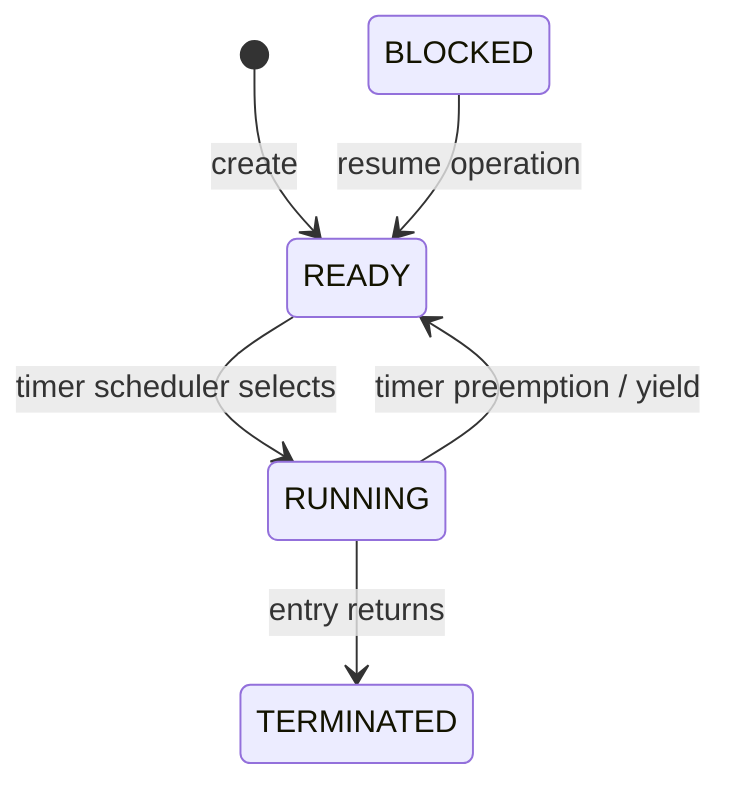

# MultiThreadOS — Educational Kernel

MultiThreadOS is a small freestanding 32-bit x86 kernel written in C and NASM. It boots as a GRUB Multiboot v1 ELF, installs its own GDT and IDT, programs the 8259 PIC and PIT, and context-switches between independent kernel stacks from a real timer interrupt. The menu works from the PS/2 keyboard or QEMU's serial console.

> The current build is intentionally a compact educational kernel. It does not implement user mode, virtual-memory isolation, a filesystem, SMP, or a general-purpose process ABI.

## Implemented features

- GRUB Multiboot v1 entry point, protected-mode GDT, and 16 KiB bootstrap stack.
- 32-bit IDT interrupt frames, remapped PIC, keyboard IRQ, and a nominal 100 Hz PIT.
- Preemptive round-robin scheduling; each thread has a separate 8 KiB kernel stack, saved register frame, state, ID, name, and execution counter. Three demonstration workers start at boot alongside the console task.
- Thread completion and terminated-slot reuse. The current demo workers are long-running; menu-created test threads terminate after a finite loop.
- Static per-thread stack bounds are visible in diagnostics; stack-overflow guards are not implemented.
- IRQ-safe spinlock and a shared-counter test that first exposes lost updates in deliberately unsynchronized split operations, then verifies the locked result.
- Scrolling VGA text output and UART output/input; the interactive menu accepts PS/2 keys or serial input.
- Scheduler/tick diagnostics, stack-boundary display, and executable kernel self-tests.

## Build dependencies

### Ubuntu / WSL2

```sh
sudo apt update
sudo apt install build-essential gcc-multilib nasm grub-pc-bin xorriso qemu-system-x86 gdb
```

The project uses `i686-elf-gcc` automatically if it is on `PATH`; otherwise it falls back to the system GCC with `-m32`. The fallback is useful for local learning and is tested here. For a dedicated cross toolchain, build/install the GNU binutils and GCC `i686-elf` targets and put their `bin` directory on `PATH`.

### Build and run

From the project root:

```sh
make clean
make
make run
```

`make` creates `bin/kernel.elf`. `make run` boots this Multiboot ELF using QEMU's direct Multiboot loader and connects the interactive UART to the terminal. QEMU displays VGA text in its window as well. Use the terminal in which QEMU is running to enter menu numbers and press Enter; the default QEMU monitor is disabled so input goes to the kernel console.

To create and boot a GRUB rescue ISO instead:

```sh
make iso
qemu-system-i386 -cdrom bin/multithreados.iso -serial stdio -no-reboot
```

ISO generation requires `grub-mkrescue` and `xorriso`. `make debug` starts the direct-ELF QEMU target paused with the GDB server on TCP port 1234; in another terminal run `gdb bin/kernel.elf`, then enter `target remote :1234` and `continue`.

## Console menu

1. Kernel/architecture information
2. Thread table and states
3. Create a finite test thread
4. Resume a blocked thread if one exists; otherwise yield to a ready thread
5. Tick and context-switch statistics
6. Lost-update demonstration, followed by the locked shared-counter test
7. Force scheduling yields and show thread progress/statistics
8. PIT ticks
9. Static thread stack addresses and sizes
10. Thread, scheduling, and synchronization self-tests
11. Help
12. Request QEMU shutdown, then attempt keyboard-controller reset

All ready threads are scheduled automatically; menu option 4 is not needed to make newly created ready threads run. The BLOCKED state is reserved, but blocking/wakeup primitives are not implemented yet, so option 4 currently yields when there is no blocked thread. Shutdown through QEMU's ISA debug-exit port depends on the emulator/device model; the keyboard-controller reset is the fallback.

## Scheduling and context switching


The interrupt stub pushes the IRQ vector and error-code slot, segment registers, and general registers. C stores that frame pointer in the current thread's TCB and chooses the next READY entry. Returning a different saved-frame pointer changes ESP before the assembly pops registers and executes `iretd`; this is the actual context switch. New threads are initialized with a synthetic frame laid out exactly like a timer-interrupted thread. A returning entry function calls `thread_exit()` and yields its final frame to the scheduler. Voluntary yields use a separate software interrupt vector, so the PIT tick counter includes hardware timer interrupts only.

### Thread-state diagram



## Source layout

- `src/kernel.asm`, `src/boot/`: Multiboot entry assembly / legacy boot source.
- `src/gdt/`: kernel GDT setup and segment reload.
- `src/idt/`: interrupt gates, PIC remap, assembly IRQ frames, dispatch.
- `src/timer/`, `src/keyboard/`, `src/serial/`, `src/io/`: PIT, PS/2, UART, and port I/O.
- `src/scheduler/`: TCBs, per-thread stacks, preemptive round-robin scheduler.
- `src/sync/`: IRQ-safe spinlock.
- `src/menu/`: interactive kernel console.
- `src/tests/`: scheduler and synchronization self-tests.
- `src/linker.ld`, `grub.cfg`, `Makefile`: ELF layout, GRUB entry, and build targets.

See [PROJECT_REPORT.md](PROJECT_REPORT.md) for the MCA-level design, test results, limitations, and future improvements.

The pre-existing paging/heap/disk and task-demo code is not part of the new build. Paging and heap initialization remain deliberately disabled: the previous code did not provide a safe Multiboot memory map allocator, and enabling its fixed-address 100 MiB heap would be unsafe. Thread stacks instead live in static kernel BSS.

## Testing performed

Validated in this development environment:

- `make clean && make -j2` — successful 32-bit freestanding ELF link using host GCC `-m32`.
- `grub-file --is-x86-multiboot bin/kernel.elf` — valid Multiboot v1 header.
- QEMU direct-ELF boot — serial output reached `Status: Kernel Initialized` and displayed the menu.
- UART menu input — PIT ticks/context-switch counts increased; the counter synchronization test reached the expected 20,000; kernel self-tests reported thread creation/execution, round-robin context switching, and synchronization passing.

The serial output spells the requested title with an ASCII hyphen (`MultiThreadOS - Educational Kernel`) for terminal compatibility. The QEMU smoke run used direct Multiboot ELF loading. A GRUB ISO has not been generated in this environment because `xorriso` is unavailable; install it as shown above before claiming/testing the ISO path.

## Troubleshooting

- **`gcc: error: ... -m32` or missing 32-bit support:** install `gcc-multilib` on Ubuntu/WSL2, or install an `i686-elf` cross toolchain.
- **`grub-mkrescue: error: xorriso not found`:** install the `xorriso` package; direct `make run` does not need ISO tools.
- **No menu input:** focus the QEMU window for PS/2 keyboard input, or type in the terminal attached to `-serial stdio`. Press Enter after an option.
- **Black screen or immediate reset:** verify `grub-file --is-x86-multiboot bin/kernel.elf`; for GRUB ISO boot, check the ISO's GRUB config and that `grub-pc-bin`/`xorriso` are installed.
- **GDB cannot connect:** start QEMU with `make debug` and connect to `:1234` before continuing.

## Limitations and future work

The PIC/PIT path is single-core, uses a fixed 10 ms quantum, and does not yet distinguish CPU time from loop iterations. The scheduler uses statically allocated stacks and a fixed thread table; stack guards, blocking/wakeup, blocking I/O queues, mutex ownership, paging-backed allocation, user mode, filesystem support, exception diagnostics, and SMP are not implemented. The IDT has a safe halt stub for exceptions other than the two configured IRQs. These are known boundaries rather than completed features.
# Deceloping-Multithreaded-Kernal
